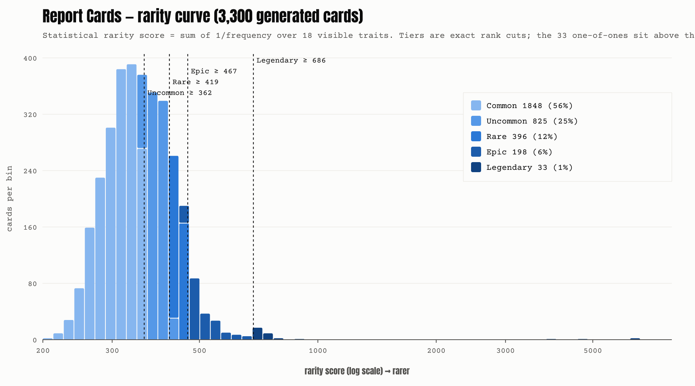

# Report Cards — the rarity curve

Generated by `npm run collection:generate` for seed `report-cards/harrow/3333/v1`. Do not edit by hand.

## Token tiers (exact)

Every generated card gets a statistical rarity score: the sum, over its 18 visible traits, of 1 / frequency. Cards are ranked by score and cut into tiers at exact counts. The 33 one-of-ones sit above everything as **1 of 1** (ranks 1–33).

| Tier | Cards | Share of 3,300 | Rank range | Score range |
| ---- | ----: | ----: | ---- | ---- |
| 1 of 1 | 33 | — | 1–33 | hand-made |
| Legendary | 33 | 1.0% | 34–66 | 686.0–6571.7 |
| Epic | 198 | 6.0% | 67–264 | 467.0–679.7 |
| Rare | 396 | 12.0% | 265–660 | 419.4–466.9 |
| Uncommon | 825 | 25.0% | 661–1485 | 362.0–419.4 |
| Common | 1848 | 56.0% | 1486–3333 | 200.9–361.9 |

## Status curve (exact quotas)

| Status | Cards | Share | Trait tier |
| ------ | ----: | ----: | ---------- |
| Needs Improvement | 990 | 30.0% | Common |
| Academic Probation | 858 | 26.0% | Common |
| Held Back | 363 | 11.0% | Uncommon |
| Most Likely to Become Exit Liquidity | 396 | 12.0% | Uncommon |
| Suspended | 264 | 8.0% | Rare |
| Expelled | 231 | 7.0% | Rare |
| Honor Roll | 195 | 5.9% | Epic |
| Valedictorian | 3 | 0.1% | Legendary |

## Every layer

`target` is the designed quota from the tier curve; `count` is what this seed allocated (a conditional value is capped at 60% of the cards its rules allow, and the difference goes to that layer's unconditional values).

### Background

Tier shares: Common 58.0% · Uncommon 26.0% · Rare 12.0% · Epic 3.0% · Legendary 1.0%

| Value | Tier | Target | Count | Share |
| ----- | ---- | -----: | ----: | ----: |
| Bus 7 (Late Again) | Common | 319 | 319 | 9.7% |
| Locker Wall (Combo Forgotten) | Common | 319 | 319 | 9.7% |
| Desk Carved 'WAGMI' | Common | 319 | 319 | 9.7% |
| Cafeteria Tray (Mystery Slot) | Common | 319 | 319 | 9.7% |
| Chalkboard (Chart Never Erased) | Common | 319 | 319 | 9.7% |
| Gym Floor (Dodgeball Zone) | Common | 319 | 319 | 9.7% |
| Detention Room (Again) | Uncommon | 215 | 215 | 6.5% |
| Principal's Carpet (Seen Things) | Uncommon | 215 | 215 | 6.5% |
| Picture Day Lasers | Uncommon | 214 | 214 | 6.5% |
| Bathroom Stall (Graffiti) | Uncommon | 214 | 214 | 6.5% |
| Sticker-Bombed Desk | Rare | 198 | 198 | 6.0% |
| Overhead Projector (Left On) | Rare | 198 | 198 | 6.0% |
| Green Candle Trading Floor | Epic | 99 | 99 | 3.0% |
| Liquidation Red | Legendary | 33 | 33 | 1.0% |

### Paper

Tier shares: Common 60.0% · Uncommon 27.0% · Rare 12.0% · Legendary 1.0%

| Value | Tier | Target | Count | Share |
| ----- | ---- | -----: | ----: | ----: |
| 1994 Dot Matrix | Common | 990 | 990 | 30.0% |
| 1999 Office Laser (Y2K Ready) | Common | 990 | 990 | 30.0% |
| 1987 Carbon Copy (Pink) | Uncommon | 446 | 446 | 13.5% |
| 2004 Inkjet (Out Of Cyan) | Uncommon | 445 | 445 | 13.5% |
| Mimeograph Purple | Rare | 396 | 396 | 12.0% |
| Gold Foil (Fridge Tier) | Legendary | 33 | 33 | 1.0% |

### School

Tier shares: Common 59.0% · Uncommon 25.0% · Rare 13.0% · Epic 3.0%

| Value | Tier | Target | Count | Share |
| ----- | ---- | -----: | ----: | ----: |
| Robinhood Chain Public School 46 | Common | 487 | 487 | 14.8% |
| St. Satoshi of the Perpetual Dip | Common | 487 | 487 | 14.8% |
| Mt. Rugmore Junior High | Common | 487 | 487 | 14.8% |
| Bagholder Valley Regional High | Common | 487 | 487 | 14.8% |
| FOMO Falls Elementary | Uncommon | 206 | 206 | 6.2% |
| Leverage Heights Middle School | Uncommon | 206 | 206 | 6.2% |
| Paper Hands Preparatory Academy | Uncommon | 206 | 206 | 6.2% |
| Summer School (Remedial Finance) | Uncommon | 206 | 206 | 6.2% |
| Exit Liquidity Charter Academy | Rare | 143 | 143 | 4.3% |
| Wen Moon Vocational & Technical | Rare | 143 | 143 | 4.3% |
| Office of Student Discipline | Rare | 143 | 143 | 4.3% |
| Diamond Hands Magnet School | Epic | 99 | 99 | 3.0% |

### Semester season

Tier shares: Common 93.8% · Uncommon 6.2%

| Value | Tier | Target | Count | Share |
| ----- | ---- | -----: | ----: | ----: |
| Fall | Common | 1032 | 1032 | 31.3% |
| Winter | Common | 1031 | 1031 | 31.2% |
| Spring | Common | 1031 | 1031 | 31.2% |
| Summer | Uncommon | 206 | 206 | 6.2% |

### Attendance

Tier shares: Common 60.0% · Uncommon 28.0% · Rare 12.0%

| Value | Tier | Target | Count | Share |
| ----- | ---- | -----: | ----: | ----: |
| Excellent (Trades In Homeroom) | Common | 660 | 660 | 20.0% |
| Satisfactory (Body Present) | Common | 660 | 660 | 20.0% |
| Spotty (Green Days Only) | Common | 660 | 660 | 20.0% |
| Perfect (Never Logs Off) | Uncommon | 462 | 462 | 14.0% |
| Chronically Absent (Chart Note) | Uncommon | 462 | 462 | 14.0% |
| Never Showed Up (Still Rugged) | Rare | 396 | 396 | 12.0% |

### Pen Marks

Tier shares: Common 58.5% · Uncommon 26.0% · Rare 12.0% · Epic 3.5% · Legendary 0.1%

| Value | Tier | Target | Count | Share |
| ----- | ---- | -----: | ----: | ----: |
| SEE ME | Common | 386 | 386 | 11.7% |
| Underlined Three Times | Common | 386 | 386 | 11.7% |
| '?!?' In The Margin | Common | 386 | 386 | 11.7% |
| Flat-Mouth Smiley | Common | 386 | 386 | 11.7% |
| Circled F (Tore The Paper) | Common | 386 | 386 | 11.7% |
| Arrow To 'WHY' | Uncommon | 286 | 286 | 8.7% |
| 'NGMI' In The Margin | Uncommon | 286 | 286 | 8.7% |
| No Marks (Harrow Gave Up) | Uncommon | 285 | 285 | 8.6% |
| Grade Changed B To F | Rare | 198 | 198 | 6.0% |
| Red Pen Exploded | Rare | 198 | 198 | 6.0% |
| Gold Star (Double-Checked) | Epic | 115 | 115 | 3.5% |
| Hearts Around The A+ | Legendary | 2 | 2 | 0.1% |

### Doodle

Tier shares: Common 57.9% · Uncommon 27.1% · Rare 12.0% · Epic 3.0%

| Value | Tier | Target | Count | Share |
| ----- | ---- | -----: | ----: | ----: |
| Rocket To The Moon | Common | 478 | 478 | 14.5% |
| Chart Only Goes Up | Common | 478 | 478 | 14.5% |
| 'HODL' Bubble Letters | Common | 478 | 478 | 14.5% |
| The Cube (Mandatory) | Common | 478 | 478 | 14.5% |
| The S (You Know The One) | Uncommon | 149 | 149 | 4.5% |
| Diamond Hands (Six Fingers) | Uncommon | 149 | 149 | 4.5% |
| Laser Eyes Self-Portrait | Uncommon | 149 | 149 | 4.5% |
| Crying Stick Figure ('ME') | Uncommon | 149 | 149 | 4.5% |
| Dream Car (Three Wheels) | Uncommon | 149 | 149 | 4.5% |
| None (Paid Attention?) | Uncommon | 148 | 148 | 4.5% |
| Yacht ('ME IN 2 WEEKS') | Rare | 132 | 132 | 4.0% |
| 'WEN MOON' Written 40 Times | Rare | 132 | 132 | 4.0% |
| Liquidation Price Math | Rare | 132 | 132 | 4.0% |
| Harrow With Devil Horns | Epic | 99 | 99 | 3.0% |

### Stain

Tier shares: Common 57.0% · Uncommon 26.0% · Rare 14.1% · Epic 3.0%

| Value | Tier | Target | Count | Share |
| ----- | ---- | -----: | ----: | ----: |
| Coffee Ring (Harrow's) | Common | 470 | 470 | 14.2% |
| Mystery Cafeteria Gravy | Common | 470 | 470 | 14.2% |
| Chocolate Milk Leak | Common | 470 | 470 | 14.2% |
| Folded Into Eighths | Common | 470 | 470 | 14.2% |
| Grape Juice Box Explosion | Uncommon | 215 | 215 | 6.5% |
| Square Pizza Grease | Uncommon | 214 | 214 | 6.5% |
| Tear Stains (Dried) | Uncommon | 214 | 214 | 6.5% |
| Hallway Shoe Print | Uncommon | 214 | 214 | 6.5% |
| Booger (Fresh-ish) | Rare | 116 | 116 | 3.5% |
| Nosebleed (Watched It Dump) | Rare | 116 | 116 | 3.5% |
| Ketchup (Hopefully) | Rare | 116 | 116 | 3.5% |
| Pristine (Never Shown To Parents) | Rare | 116 | 116 | 3.5% |
| Scorched (Tried To Burn It) | Epic | 99 | 99 | 3.0% |

### Parent Signature

Tier shares: Common 57.0% · Uncommon 25.0% · Rare 13.0% · Epic 5.0%

| Value | Tier | Target | Count | Share |
| ----- | ---- | -----: | ----: | ----: |
| Mom (Disappointed Cursive) | Common | 470 | 470 | 14.2% |
| Dad (Illegible, Furious) | Common | 470 | 470 | 14.2% |
| Forged (Poorly) | Common | 470 | 470 | 14.2% |
| Unsigned ('Pending') | Common | 470 | 470 | 14.2% |
| Forged (Green Crayon) | Uncommon | 275 | 275 | 8.3% |
| Grandma (Has Questions) | Uncommon | 275 | 275 | 8.3% |
| Parent Is Also Down Bad | Uncommon | 275 | 275 | 8.3% |
| Signed At 3:12 AM | Rare | 143 | 143 | 4.3% |
| Signed By The Dog | Rare | 143 | 143 | 4.3% |
| Parent Wrote 'gm' | Rare | 143 | 143 | 4.3% |
| Signed By The Group Chat | Epic | 83 | 83 | 2.5% |
| Both Parents (Rare Alliance) | Epic | 83 | 83 | 2.5% |

### Incident

Tier shares: Common 58.0% · Uncommon 25.0% · Rare 13.5% · Epic 3.5%

| Value | Tier | Target | Count | Share |
| ----- | ---- | -----: | ----: | ----: |
| None (Allegedly) | Common | 1914 | 1914 | 58.0% |
| Nurse's Pass (Rugged) | Uncommon | 206 | 206 | 6.2% |
| Fight In Cafeteria | Uncommon | 206 | 206 | 6.2% |
| Hall Pass (Never Came Back) | Uncommon | 206 | 206 | 6.2% |
| Confiscated Note ('100x') | Uncommon | 206 | 206 | 6.2% |
| Gifted & Talented (Whale) | Rare | 149 | 149 | 4.5% |
| Withdrawal Notice (Liquidated) | Rare | 149 | 149 | 4.5% |
| Lunch Debt (Gas Fees) | Rare | 148 | 148 | 4.5% |
| Permission Slip (100x Field Trip) | Epic | 116 | 116 | 3.5% |

### Teacher Comment

Tier shares: Common 58.0% · Uncommon 24.5% · Rare 12.8% · Epic 4.5% · Legendary 0.1%

| Value | Tier | Target | Count | Share |
| ----- | ---- | -----: | ----: | ----: |
| Forged a permission slip for a 100x leverage field trip. The bus never came back. | Epic | 33 | 33 | 1.0% |
| Bright student. Refuses to learn. | Common | 26 | 30 | 0.9% |
| Talks a lot in class about 'generational wealth.' Has $11. | Common | 26 | 30 | 0.9% |
| Was seen trading during the fire drill. From inside the building. | Common | 26 | 30 | 0.9% |
| Insists every test is 'still early.' | Common | 26 | 30 | 0.9% |
| Says 'gm' to me every morning. It has never once been a good morning. | Common | 26 | 30 | 0.9% |
| Calls the cafeteria 'the trenches.' It is a cafeteria. There is pudding. | Common | 26 | 30 | 0.9% |
| Replaced the book report with a chart. The chart went down. So did the grade. | Common | 26 | 30 | 0.9% |
| Draws candles instead of taking notes. All red. At least it's honest. | Common | 26 | 30 | 0.9% |
| Wrote 'few understand' on the chalkboard. We understand. We are concerned. | Common | 26 | 30 | 0.9% |
| Has announced 'this is the bottom' eight times this term. | Common | 26 | 30 | 0.9% |
| Tried to pay for the field trip in a coin that no longer exists. | Common | 26 | 30 | 0.9% |
| Has 14 followers. 12 are bots. 2 are me, reporting the account. | Common | 26 | 30 | 0.9% |
| Does not work well with others. Works even worse alone. | Common | 26 | 30 | 0.9% |
| Needs to apply themself. Applied for a loan instead. | Common | 26 | 30 | 0.9% |
| Asked if the pop quiz had a presale. | Common | 26 | 30 | 0.9% |
| Refers to lunch money as 'dry powder.' | Common | 26 | 30 | 0.9% |
| Brought a chart to show-and-tell. Three classmates cried. One sold. | Common | 26 | 30 | 0.9% |
| Career goal: whale. Backup career goal: exit liquidity for a whale. | Common | 26 | 30 | 0.9% |
| Keeps asking for 'alpha' in the teachers' lounge. It's decaf in there. | Common | 26 | 30 | 0.9% |
| Uses the word 'conviction' to describe forgetting their password. | Common | 26 | 30 | 0.9% |
| Wants to be an influencer. Currently influencing me toward early retirement. | Common | 26 | 30 | 0.9% |
| Every trade this term was a mistake, including the ones that worked. | Common | 26 | 30 | 0.9% |
| Must learn to raise hand before speaking. And before buying. | Common | 26 | 29 | 0.9% |
| Asleep in class again. Says they were up 'watching the Asia open.' | Common | 26 | 29 | 0.9% |
| Has been asked repeatedly to stop buying after 300% candles. | Common | 26 | 26 | 0.8% |
| Only buys after Grandma asks about it. Grandma always asks at the top. | Common | 26 | 26 | 0.8% |
| Arrives at every party exactly when the cops do. | Common | 26 | 26 | 0.8% |
| A natural top signal. Other students check this card before selling. | Common | 26 | 26 | 0.8% |
| Waits for confirmation. Confirmation is always the top. | Common | 26 | 26 | 0.8% |
| Has never once turned in the assignment titled 'sell.' | Common | 26 | 26 | 0.8% |
| Was up 40x in October and would like everyone to know. Is not up now. | Common | 26 | 26 | 0.8% |
| Unrealized gains are not a grade. We have discussed this. Twice. | Common | 26 | 26 | 0.8% |
| Keeps showing me the screenshot. I asked where the money is. Silence. | Common | 26 | 26 | 0.8% |
| Believes the sell button is a trap. Has never tested this theory. | Common | 26 | 26 | 0.8% |
| Mother requested conference. | Common | 26 | 26 | 0.8% |
| Was found running with scissors. Leveraged scissors. | Common | 26 | 26 | 0.8% |
| Put the college fund into a coin with a hamster on the logo. | Common | 26 | 26 | 0.8% |
| Uses 50x leverage 'to be safe.' | Common | 26 | 26 | 0.8% |
| Does not believe in stop-losses. Believes in prayer and ALL CAPS. | Common | 26 | 26 | 0.8% |
| Refuses to let go of things that have clearly died. | Common | 26 | 26 | 0.8% |
| Locker smells. Locker contains positions from last September. | Common | 26 | 26 | 0.8% |
| Carries bags so heavy the nurse is worried about their posture. | Common | 26 | 26 | 0.8% |
| Now calls it 'long-term investing.' Did not call it that on the way in. | Common | 26 | 26 | 0.8% |
| Please stop drawing rockets on the desk. | Common | 26 | 26 | 0.8% |
| Cannot be left alone near anything with a dog on it. | Common | 26 | 26 | 0.8% |
| Buys anything with a cartoon animal on it. We removed the classroom posters. | Common | 26 | 26 | 0.8% |
| Did the book report on a one-page whitepaper. The report was longer. | Common | 26 | 26 | 0.8% |
| Left the field trip early and missed the good part. | Common | 26 | 26 | 0.8% |
| Paper hands. We have tried laminating them. | Common | 26 | 26 | 0.8% |
| Sold at 2x. It went 40x. Has not spoken since. | Common | 26 | 26 | 0.8% |
| Sells at the first sign of green. Also red. Also lunch. | Common | 26 | 26 | 0.8% |
| Hands visibly shake during tests. And during green candles. | Common | 26 | 26 | 0.8% |
| The red pen ran out halfway down this card. That's on you. | Common | 26 | 26 | 0.8% |
| An F is not a dip. Please stop averaging down on it. | Common | 26 | 26 | 0.8% |
| Shows promise when supervised. Is never supervised. | Common | 26 | 26 | 0.8% |
| Almost did the right thing twice this semester. Growth. | Common | 26 | 26 | 0.8% |
| Knows exactly what to do. Does the other thing. | Common | 26 | 26 | 0.8% |
| Could be a B student if the B didn't stand for 'bags.' | Common | 26 | 26 | 0.8% |
| Please see me. Actually, please see a financial advisor. Then me. | Common | 26 | 26 | 0.8% |
| One more rug and we call your mother. She has asked us not to. | Common | 26 | 26 | 0.8% |
| On thin ice. Currently trying to open a leveraged position on the ice. | Common | 26 | 26 | 0.8% |
| Grades are 'down only.' Student insists it's a trend, not a problem. | Common | 26 | 26 | 0.8% |
| Has until end of term to turn this around. Has already bought more. | Common | 26 | 26 | 0.8% |
| Always here early. Brings the chart to homeroom like it's the class pet. | Common | 26 | 26 | 0.8% |
| Physically present. Mentally watching a one-minute chart. | Common | 26 | 26 | 0.8% |
| Only comes to school on green days. | Common | 26 | 26 | 0.8% |
| Shows up when it's green. Hides in the nurse's office when it's red. | Common | 26 | 26 | 0.8% |
| Snow day. School closed. Market didn't. Lost money from under a blanket. | Common | 26 | 26 | 0.8% |
| Came back from spring break broke. Did not go anywhere. | Common | 26 | 26 | 0.8% |
| Back-to-school supplies: pencils, eraser, 40x leverage. | Common | 26 | 26 | 0.8% |
| A pleasure to have in class. We are frankly suspicious. | Epic | 33 | 24 | 0.7% |
| Copies trades from another student. Unfortunately, it's working. | Epic | 33 | 24 | 0.7% |
| Took profit, managed risk, went to bed. We don't know what to do with this child. | Epic | 33 | 23 | 0.7% |
| Proud of this one. Keep them away from the other children. | Epic | 33 | 23 | 0.7% |
| Excellent term. Wallet has been sent to the office for a random search. | Epic | 33 | 23 | 0.7% |
| Sold into a green candle. Classmates think it's witchcraft. Nobody sits near them. | Rare | 22 | 22 | 0.7% |
| Keeps a spreadsheet. Was stuffed in a locker for it. The locker was hedged. | Rare | 22 | 22 | 0.7% |
| Traded a milk-cap collection for a memecoin. The milk caps are up. | Rare | 22 | 22 | 0.7% |
| Turned in a blank page and called it a 'stealth launch.' | Rare | 22 | 22 | 0.7% |
| Sent home for three days. Traded all three. Came back worse. | Rare | 22 | 22 | 0.7% |
| Suspended for running a pump group out of the library. It was very quiet. | Rare | 22 | 22 | 0.7% |
| Banned from the computer lab until further notice. And the calculator. | Rare | 22 | 22 | 0.7% |
| Referred to Gifted & Talented. Parents are advised to hide their wallets. | Rare | 22 | 22 | 0.7% |
| Moved the entire market during snack time. Please leave some for the others. | Rare | 22 | 22 | 0.7% |
| Bought the cafeteria. We do not know how to discipline a shareholder. | Rare | 22 | 22 | 0.7% |
| Spent lunch money on gas fees. Ate a ketchup packet for protein. | Rare | 22 | 22 | 0.7% |
| Never came to class. Still somehow got rugged. | Rare | 22 | 22 | 0.7% |
| Stop sniffing the report card. It is not going to get better. | Rare | 21 | 21 | 0.6% |
| The district has asked me to stop writing 'good riddance.' Good riddance. | Rare | 22 | 20 | 0.6% |
| Expelled. Asked if the expulsion could be tokenized. | Rare | 22 | 20 | 0.6% |
| Please collect belongings from the front office. It's one bag. It's down 98%. | Rare | 22 | 20 | 0.6% |
| Ran with scissors, into traffic, on 50x. The scissors are fine. | Rare | 22 | 20 | 0.6% |
| Liquidated during a spelling test. Spelled 'margin call' correctly, at least. | Rare | 22 | 20 | 0.6% |
| Borrowed against lunch money to buy more lunch money. | Rare | 22 | 19 | 0.6% |
| Fell asleep during the filmstrip. Woke up liquidated. | Rare | 22 | 19 | 0.6% |
| Calls me 'ser.' I asked them to stop. They said 'ser, no.' | Uncommon | 15 | 15 | 0.5% |
| Signs every assignment 'not financial advice.' It's a spelling test. | Uncommon | 15 | 15 | 0.5% |
| Took financial advice from the class hamster. The hamster is up. | Uncommon | 15 | 15 | 0.5% |
| Explained leverage to the kindergarteners. Two are now liquidated. | Uncommon | 15 | 15 | 0.5% |
| Mother requested conference. Father requested a refund. | Uncommon | 15 | 15 | 0.5% |
| Parents were called. Turns out they were also in the trade. | Uncommon | 15 | 15 | 0.5% |
| Traded the class field trip fund. This year's field trip is the parking lot. | Uncommon | 15 | 15 | 0.5% |
| 31 years of teaching. This card is why I am retiring in May. | Uncommon | 15 | 15 | 0.5% |
| Bought the high of the year. Twice. Same coin. Same afternoon. | Uncommon | 15 | 15 | 0.5% |
| Buys the top with the precision of a sniper who is also the target. | Uncommon | 15 | 15 | 0.5% |
| Never buys the top. Buys the floor, then the basement, then the crawlspace. | Uncommon | 15 | 15 | 0.5% |
| Occasionally early. Mostly early to things that never happen. | Uncommon | 15 | 15 | 0.5% |
| Rode a 50x all the way back down to keep it company. | Uncommon | 15 | 15 | 0.5% |
| Actually sold something. The class gave a standing ovation. One child wept. | Uncommon | 15 | 15 | 0.5% |
| Takes profit like an adult. We have notified the authorities. | Uncommon | 15 | 15 | 0.5% |
| Set slippage to 49% and called it 'being decisive.' | Uncommon | 15 | 15 | 0.5% |
| Keeps seed phrase taped inside locker door. The locker does not lock. | Uncommon | 15 | 15 | 0.5% |
| Lost the permission slip, the library book and 80% of the college fund. | Uncommon | 15 | 15 | 0.5% |
| Holds 40% stables. The most boring child I have ever loved. | Uncommon | 15 | 15 | 0.5% |
| Wears a helmet to recess. Diversified across all four slides. | Uncommon | 15 | 15 | 0.5% |
| Down 91%. Describes the position as 'a family heirloom.' | Uncommon | 15 | 15 | 0.5% |
| Still holding a coin whose developer has since become a dentist. | Uncommon | 15 | 15 | 0.5% |
| Travels light. Suspiciously light. Where did the bags go. | Uncommon | 15 | 15 | 0.5% |
| Bought a coin named after the cafeteria fish sticks. It 10x'd. Worst possible lesson. | Uncommon | 15 | 15 | 0.5% |
| Launched a token called $RECESS during recess. Recess has been canceled. | Uncommon | 15 | 15 | 0.5% |
| Pays attention in class. The other children find this deeply upsetting. | Uncommon | 15 | 15 | 0.5% |
| Stays for the whole movie. Even the bad ones. Especially the bad ones. | Uncommon | 15 | 15 | 0.5% |
| Did not turn in work. Says the work is 'still in the mempool.' | Uncommon | 15 | 15 | 0.5% |
| Incomplete. Student says the assignment is 'vesting.' | Uncommon | 15 | 15 | 0.5% |
| Will be repeating this semester. And, statistically, the next one. | Uncommon | 15 | 15 | 0.5% |
| Repeating the grade. Also repeating the exact same trade. | Uncommon | 15 | 15 | 0.5% |
| Held back again. Now the tallest kid in class. Still buying their tops. | Uncommon | 15 | 15 | 0.5% |
| Other students have been seen selling to this child at lunch. | Uncommon | 15 | 15 | 0.5% |
| Always the last one holding the ball when the music stops. | Uncommon | 15 | 15 | 0.5% |
| The whole class sold to this student. Every single one. On purpose. | Uncommon | 15 | 15 | 0.5% |
| A generous student. Absorbs everyone's sell orders. Never complains. | Uncommon | 15 | 15 | 0.5% |
| Voted 'Most Likely.' Already did it. Before the yearbook came out. | Uncommon | 15 | 15 | 0.5% |
| Sent to the nurse after a token pulled the rug. Ice pack administered. | Uncommon | 15 | 15 | 0.5% |
| Dev ran off with the lunch money. Student insists dev is 'still building.' | Uncommon | 15 | 15 | 0.5% |
| Still in the group chat for a coin that no longer exists. Still says gm. | Uncommon | 15 | 15 | 0.5% |
| Twelve trades in one lunch period. A tray was thrown. So was a chart. | Uncommon | 15 | 15 | 0.5% |
| Involved in a cafeteria altercation over the market cap of a tot. | Uncommon | 15 | 15 | 0.5% |
| Asked for the hall pass 31 times. Transferred everything to 'a friend.' | Uncommon | 15 | 15 | 0.5% |
| Left for the bathroom in October. The wallet has not returned. | Uncommon | 15 | 15 | 0.5% |
| Caught passing a note: '100x, tell no one.' It had been passed to 31 people. | Uncommon | 15 | 15 | 0.5% |
| Perfect attendance. Has not slept since the chain launched. | Uncommon | 15 | 15 | 0.5% |
| Never misses a day. Never misses a top. | Uncommon | 15 | 15 | 0.5% |
| Absent 31 days. Doctor's note was a screenshot of a chart. | Uncommon | 15 | 15 | 0.5% |
| A joy to have in class when absent. Which is always. | Uncommon | 15 | 15 | 0.5% |
| The printer jammed on this student's grades. Even the printer has limits. | Uncommon | 15 | 15 | 0.5% |
| Prepared for Y2K by buying a coin called $Y2K. The computers survived. The coin did not. | Uncommon | 15 | 15 | 0.5% |
| The pink copy was supposed to go to a parent. It went to the group chat. | Uncommon | 15 | 15 | 0.5% |
| Summer school again. Tan lines are from the monitor. | Uncommon | 15 | 15 | 0.5% |
| Failed the regular year. Now failing the summer. Consistency is something. | Uncommon | 15 | 15 | 0.5% |
| Sold the top, bought the bottom, took the bus home. First one in 34 years. | Legendary | 11 | 1 | 0.0% |
| The only student who ever listened. I framed this card. I do not frame things. | Legendary | 11 | 1 | 0.0% |
| Graduation speech will be one word long. The word is 'sell.' | Legendary | 11 | 1 | 0.0% |

## Grades (rule-driven, not rolled)

Grades come from each card's status: six scores are generated so the app's own `determineStatus` (src/lib/grading.ts) prints exactly the allocated status. Letter counts per subject:

| Subject | A+ | A | A- | B+ | B | B- | C+ | C | C- | D+ | D | D- | F | I |
| ------- | --: | --: | --: | --: | --: | --: | --: | --: | --: | --: | --: | --: | --: | --: |
| Buying the Top | 255 | 270 | 165 | 102 | 129 | 98 | 84 | 127 | 94 | 94 | 97 | 84 | 1672 | 29 |
| Taking Profit | 146 | 157 | 123 | 116 | 159 | 118 | 122 | 169 | 110 | 89 | 121 | 79 | 1751 | 40 |
| Risk Management | 149 | 189 | 145 | 134 | 167 | 125 | 120 | 150 | 112 | 111 | 136 | 86 | 1648 | 28 |
| Holding Bags | 138 | 159 | 104 | 119 | 139 | 108 | 129 | 129 | 113 | 101 | 127 | 82 | 1813 | 39 |
| Chasing Memes | 207 | 192 | 144 | 121 | 189 | 148 | 96 | 130 | 92 | 88 | 93 | 77 | 1694 | 29 |
| Selling Too Early | 129 | 144 | 100 | 100 | 136 | 113 | 110 | 136 | 100 | 104 | 122 | 73 | 1893 | 40 |

## The 20 rarest generated cards

| Rank | Token | Tier | Score | Status | Why |
| ---: | ----: | ---- | ----: | ------ | --- |
| 34 | #2061 | Legendary | 6571.7 | Valedictorian | Teacher Comment: The only student who ever listened. I framed this card. I do not frame things. (1); Pen Marks: Hearts Around The A+ (2) |
| 35 | #1081 | Legendary | 6223.5 | Valedictorian | Teacher Comment: Graduation speech will be one word long. The word is 'sell.' (1); Pen Marks: Hearts Around The A+ (2) |
| 36 | #1586 | Legendary | 4607.0 | Valedictorian | Teacher Comment: Sold the top, bought the bottom, took the bus home. First one in 34 years. (1); Status: Valedictorian (3) |
| 37 | #2607 | Legendary | 3819.3 | Honor Roll | Semester: Summer 1996 (1); Teacher Comment: Stays for the whole movie. Even the bad ones. Especially the bad ones. (15) |
| 38 | #3063 | Legendary | 878.0 | Honor Roll | Semester: Spring 1996 (10); Teacher Comment: A pleasure to have in class. We are frankly suspicious. (24) |
| 39 | #1928 | Legendary | 793.5 | Honor Roll | Semester: Winter 1996 (11); Teacher Comment: Copies trades from another student. Unfortunately, it's working. (24) |
| 40 | #11 | Legendary | 776.6 | Honor Roll | Semester: Winter 1996 (11); Teacher Comment: Referred to Gifted & Talented. Parents are advised to hide their wallets. (22) |
| 41 | #2671 | Legendary | 769.6 | Honor Roll | Semester: Spring 1996 (10); Teacher Comment: The red pen ran out halfway down this card. That's on you. (26) |
| 42 | #1536 | Legendary | 766.4 | Honor Roll | Semester: Winter 1996 (11); Teacher Comment: Never buys the top. Buys the floor, then the basement, then the crawlspace. (15) |
| 43 | #138 | Legendary | 763.6 | Honor Roll | Semester: Fall 1996 (11); Teacher Comment: Proud of this one. Keep them away from the other children. (23) |
| 44 | #993 | Legendary | 759.1 | Honor Roll | Semester: Spring 1996 (10); Teacher Comment: Proud of this one. Keep them away from the other children. (23) |
| 45 | #2478 | Legendary | 757.2 | Honor Roll | Semester: Spring 1996 (10); Teacher Comment: Moved the entire market during snack time. Please leave some for the others. (22) |
| 46 | #2589 | Legendary | 745.9 | Honor Roll | Semester: Fall 1996 (11); Teacher Comment: A pleasure to have in class. We are frankly suspicious. (24) |
| 47 | #2914 | Legendary | 744.8 | Honor Roll | Semester: Fall 1996 (11); Teacher Comment: Proud of this one. Keep them away from the other children. (23) |
| 48 | #274 | Legendary | 730.2 | Honor Roll | Semester: Fall 1996 (11); Teacher Comment: Spent lunch money on gas fees. Ate a ketchup packet for protein. (22) |
| 49 | #1616 | Legendary | 724.5 | Honor Roll | Semester: Winter 1996 (11); Teacher Comment: Took profit, managed risk, went to bed. We don't know what to do with this child. (23) |
| 50 | #878 | Legendary | 723.9 | Honor Roll | Semester: Spring 1996 (10); Teacher Comment: Copies trades from another student. Unfortunately, it's working. (24) |
| 51 | #515 | Legendary | 723.8 | Honor Roll | Semester: Winter 1996 (11); Teacher Comment: Proud of this one. Keep them away from the other children. (23) |
| 52 | #2208 | Legendary | 723.6 | Honor Roll | Semester: Fall 1996 (11); Teacher Comment: Back-to-school supplies: pencils, eraser, 40x leverage. (26) |
| 53 | #441 | Legendary | 723.3 | Honor Roll | Semester: Fall 1996 (11); Teacher Comment: Copies trades from another student. Unfortunately, it's working. (24) |

## One-of-ones

| Rank | Token | Title |
| ---: | ----: | ----- |
| 1 | #835 | The Permanent Record |
| 2 | #1515 | The Dog Ate It |
| 3 | #1874 | Laminated By Mom |
| 4 | #2107 | Snow Day |
| 5 | #2855 | The Rug Pull |
| 6 | #1938 | Substitute Teacher |
| 7 | #2958 | Fire Drill |
| 8 | #602 | Y2K Time Capsule |
| 9 | #1047 | The Kid Who Sold The Top |
| 10 | #550 | Expelled From The Blockchain |
| 11 | #3072 | The Principal's Own Wallet |
| 12 | #3159 | Hall Monitor |
| 13 | #2246 | Summer School Lifer |
| 14 | #2276 | Wallet-Sized |
| 15 | #1480 | Bubble Sheet Masterpiece |
| 16 | #2554 | Science Fair Volcano |
| 17 | #1831 | Signed Yearbook |
| 18 | #537 | Parent-Teacher Conference |
| 19 | #1808 | Grade 10, Attempt 26 |
| 20 | #2282 | Gifted & Talented (Whale Division) |
| 21 | #772 | Nurse's Punch Card |
| 22 | #1698 | Confiscated Pager |
| 23 | #893 | I Will Not Buy The Top |
| 24 | #525 | The Forgery Kit |
| 25 | #3147 | Show And Tell |
| 26 | #1827 | The Class Hamster |
| 27 | #3329 | Harrow's Own Report Card |
| 28 | #3045 | Made It To The Moon |
| 29 | #1957 | Stuck Under The Desk |
| 30 | #1697 | Scratch And Sniff |
| 31 | #3192 | The Airdrop |
| 32 | #1589 | Chain Letter |
| 33 | #2317 | Sent To The Corner |
